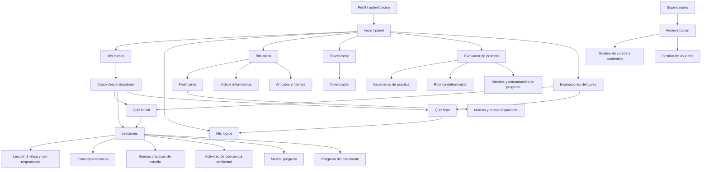
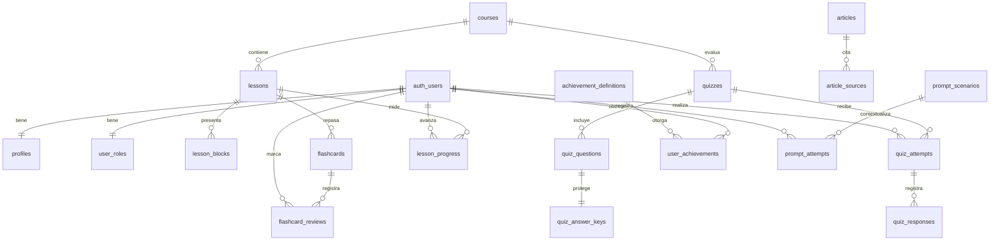

# Mapa de navegación

Las rutas principales son `/`, `/cursos`, `/leccion/:slug`, `/logros`, `/flashcards`, `/evaluaciones`, `/videos`, `/articulos`, `/herramientas` (solo tokenizador) y `/evaluador`. El catálogo, lecciones, artículos, videos y logros leen contenido publicado desde Supabase; progreso, Evaluador, evaluaciones y flashcards usan Supabase Auth para guardar datos por estudiante. La primera lección trata de integridad académica, autoría y aprendizaje propio.

## Perfiles y permisos previstos

| Rol | Acceso previsto |
| --- | --- |
| Estudiante | Leer contenido publicado; escribir y leer su propio progreso, intentos, respuestas y repaso. |
| Administrador | Crear y editar contenido educativo; consultar registros necesarios para gestionar la plataforma. |
| Superusuario | Administrar roles, perfiles y configuración global, además del contenido. |

La autorización vive en PostgreSQL mediante RLS. Ocultar enlaces en Angular no concede ni revoca permisos. Los estudiantes no pueden leer claves de respuestas ni asignarse roles. Las respuestas correctas se mantienen en `quiz_answer_keys`; una función RPC valida y califica los intentos sin exponer esa tabla al cliente.

## Relaciones principales de Supabase

Todas las tablas públicas, incluidas las tablas preexistentes `carros` y `usuarios`, tienen RLS habilitada. El contenido educativo solo se muestra cuando el curso y el recurso correspondiente están publicados. Los factores de energía y agua están vacíos y marcados `// TODO: completar con fuente verificable` en la migración; no se debe mostrar una cifra ambiental hasta documentar metodología y fuente.
